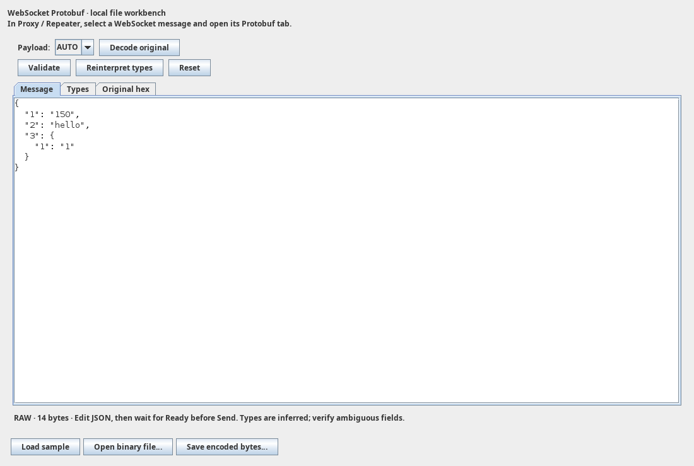

# WebSocket Protobuf

View and edit Protobuf data inside Burp Suite WebSocket messages.



## Install

The extension requires **Java 21 or newer** in the runtime used by Burp. Building from source requires a **JDK 21 or newer**; the JAR targets Java 21.

Manually tested with **Burp Suite Professional 2026.7.3** on Linux using **Oracle Java 24.0.2**. Automated tests also run on Java 21.

In Burp, open **Extensions → Installed → Add**, select **Java**, and choose the extension JAR.

## Use

1. Select a WebSocket message and open its **Protobuf** tab.
2. Inspect the decoded data under **Message**.
3. In an editable context such as Repeater, change a value.
4. Wait for **Ready**, then send using Burp's normal controls.

**Types** lets you correct inferred field types. **Reinterpret types** applies those rules to the original bytes and discards message edits. **Reset** restores the original message.

Supported payloads: raw Protobuf, gzip, and uncompressed gRPC. Field names are displayed as numbers because no schema is required. Type inference can be ambiguous; `.proto` import and compressed gRPC are not supported. Unchanged messages keep their original bytes.

In manual Repeater testing with the Burp version above, submitting an invalid edit resulted in Burp sending the original payload. Wait for **Ready** to ensure your edited payload is used.

### Correct inferred types

For example, to interpret field `1` as a ZigZag signed integer, replace the **Types** JSON with:

```json
{
  "1": { "type": "sint" }
}
```

Click **Reinterpret types**. The original bytes are decoded again with that rule; omitted fields are inferred automatically. In the built-in sample, field `1` changes from unsigned `"150"` to signed `"75"`. This replaces any Message edits, so set the types before editing values.

Use `bytes` for Base64 data and `message` with a `message_typedef` object for nested messages. Numeric types include `uint`, `int`, `sint`, `fixed32`, `fixed64`, `sfixed32`, `sfixed64`, `float`, `double`, and the explicit `uint32`/`int32`/`sint32` and `uint64`/`int64`/`sint64` variants. A `packed_` prefix, such as `packed_uint`, represents a repeated numeric field as an array. Numeric definitions accept both packed and unpacked records, including a mixture in the same field. Values represented as decimal strings retain full 64-bit precision.

### Processing limits

- Binary input and encoded output: **8 MiB** each. Gzip inflation is also limited to **8 MiB**.
- Decoded/formatted Message and Types JSON: **16 MiB combined**.
- Message nesting: **64 levels**; decoded fields and packed elements share a **100,000-entry** budget.
- gRPC payload: at most **1,024 records**. Editing preserves the record count.

## Build

Use JDK 21. From the project folder, run:

```sh
./gradlew clean check jar
```

On Windows, use `gradlew.bat clean check jar`.

This downloads the build tools and dependencies on the first run, runs the tests, and produces the file Burp loads:

```text
build/libs/burp-websocket-protobuf-0.1.0.jar
```

## Try it without Burp

```sh
java -jar build/libs/burp-websocket-protobuf-0.1.0.jar
```

Click **Load sample**, edit the JSON, wait for **Ready**, and use **Save encoded bytes…**. The `examples/` folder contains sample payloads and JSON files. Processing stays on your computer.

The JAR also provides a command-line interface:

```sh
java -jar build/libs/burp-websocket-protobuf-0.1.0.jar --decode examples/hello.bin
java -jar build/libs/burp-websocket-protobuf-0.1.0.jar --encode examples/hello.bin examples/hello.json examples/hello.types.json hello.edited.bin
```

Both commands accept an optional final encoding: `auto`, `raw`, `gzip`, or `grpc`. Encoding requires an output path that does not already exist. Use `--help` for usage.

## CI downloads

The GitHub Actions workflow builds and tests on Linux, Windows, and macOS with JDK 21. Each successful job uploads its JAR as an artifact under **Actions → Build and test → workflow run → Artifacts**. The workflow does not create a GitHub Release; release assets are published separately.

## Project files

- `src/main/java/` — the Java source code.
- `src/test/java/` — automated checks for the code.
- `examples/` — sample data for trying the extension.
- `build.gradle.kts` — instructions for building the JAR.
- `gradlew`, `gradlew.bat`, and `gradle/` — the build tools and pinned dependencies.
- `build/` — generated files; excluded from Git.

## License

[MIT](LICENSE). See [third-party notices](THIRD-PARTY-NOTICES.md) for dependency licenses.
